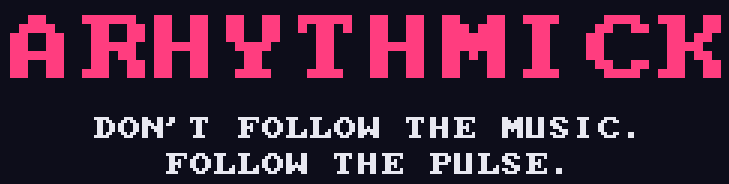
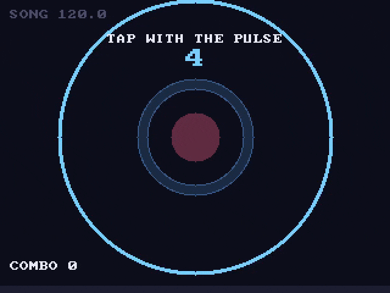

<p align="center">
  
</p>

**Arhythmick** is a silly anti-rhythm game, packaged as a [libretro](https://www.libretro.com/) core so it runs in RetroArch on PCs, handhelds and anything else with a libretro frontend.

You load a song. The game finds its tempo and hands you a pulse that is *almost* that tempo, only slightly off on purpose. Your job is to tap that pulse, steadily, until the song ends. The music will do its best to pull you off it.

<p align="center">
  
</p>

## How it plays

1. **Lead-in:** the pulse starts on its own, with no music, so you can lock onto it.
2. **The song fades in** with its beat landing exactly on your pulse. It feels right at first.
3. **It drifts.** The pulse never changes, but because it's slightly detuned, the song slides away from it. If you start following the music, you'll miss.

Rings shrink toward the blue hit zone and cross its centre exactly on each pulse. The zone is as wide as the Perfect window. The button in the middle bounces when you press and flashes green for Perfect or yellow for Near.

You fail on the first:
- press too far from a pulse,
- pulse you let pass without a press, or
- extra press between pulses.

Near misses are allowed.

## Controls

| Button | Action |
| --- | --- |
| A / B / X / Y | Tap |
| Start | Start / retry |
| Select | Back to title |

## Core options

| Option | What it does |
| --- | --- |
| Drift | **Subtle:** starts in sync and slides steadily to half a beat off by the end. **Wobbly:** slides out of phase and back twice. **Chaotic:** five times. |
| Fail Window | How far off a press can be before you fail (80–150 ms). |
| Perfect Window | Presses within this are Perfect, and it sets the hit-zone width (30–60 ms). |
| Lead-in Beats | Pulses before the song starts (4, 8 or 16). |
| Latency Offset | Raise this if your presses register late (Bluetooth controllers, TVs). |

The pulse is always between 50 and 100 BPM. Faster songs get a pulse at half (or a quarter of) their tempo.

## Supported files

MP3, OGG Vorbis, FLAC and WAV.

## Building

You need a C99 compiler and `make`, and nothing else.

```sh
make            # builds arhythmick_libretro.so (.dll / .dylib on Windows / macOS)
make install    # copies the core and .info file into ~/.config/retroarch/{cores,info}
make test       # unit tests
make tools      # builds build/analyze, which prints the tempo and pulse for a song
```

Cross-compiling:
- **ARM handhelds:** `make platform=unix CC=arm-linux-gnueabihf-gcc` (or your device's toolchain).
- **Frontends that link cores statically:** `make platform=static`.

## Running it in RetroArch

```sh
retroarch -L ~/.config/retroarch/cores/arhythmick_libretro.so path/to/song.mp3
```

> **Getting the FFmpeg player instead?** RetroArch sends audio files to its built-in media player by default. Turn off **Settings → File Browser → Use Built-In Media Player**, then load the song again.

If you install with `make install`, point **Settings → Directory → Cores** and **Core Info** at `~/.config/retroarch/cores` and `~/.config/retroarch/info` so the core shows up under Load Core.

## Credits

Arhythmick bundles these single-file libraries:
- [dr_mp3, dr_flac, dr_wav](https://github.com/mackron/dr_libs) by David Reid (public domain / MIT-0)
- [stb_vorbis](https://github.com/nothings/stb) by Sean Barrett (public domain / MIT)
- [font8x8](https://github.com/dhepper/font8x8) by Daniel Hepper (public domain)
- `libretro.h` from [libretro-common](https://github.com/libretro/libretro-common) (MIT)

## License

Arhythmick is released under the [MIT License](LICENSE). The bundled libraries keep their own licenses, listed above.
